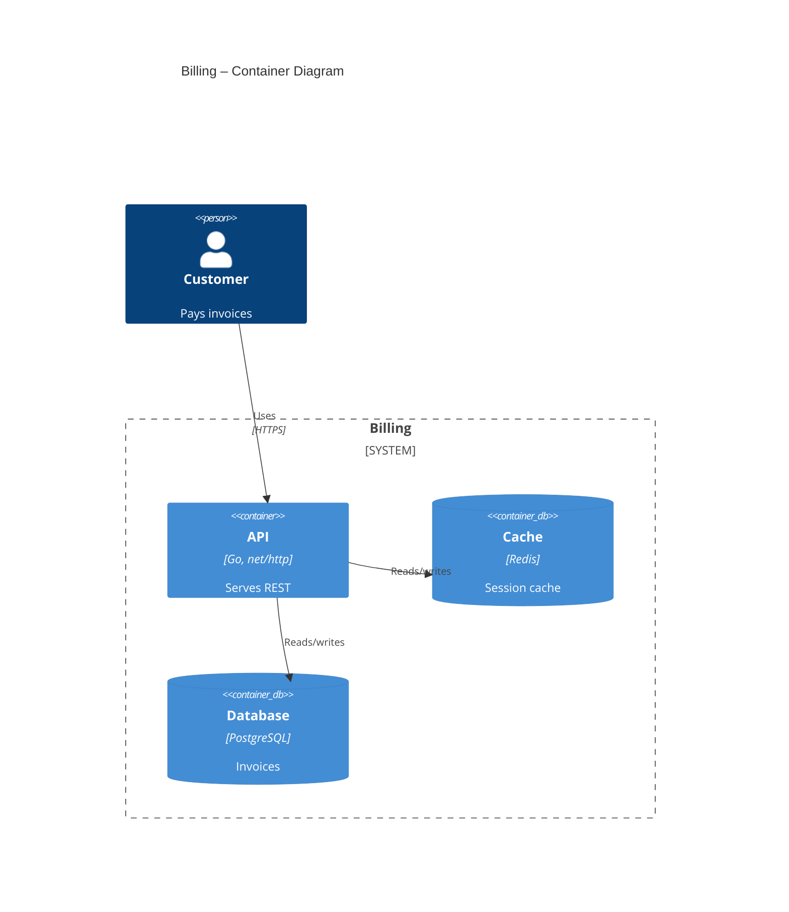

Update the architecture docs, the code has changed. Treat the facts below as what you found in the code and do not invent anything beyond them.

Changes since the last run: the Redis cache was removed from `docker-compose.yml`, and a new `worker` service (`worker/main.py`, Python, consumes the `invoices` queue on RabbitMQ with `pika`) was added.

Current `docs/c4-containers.md`:

````markdown
<!-- architecture: auto-generated — edit the Mermaid block only, keep other text -->
# Container Diagram

> Last updated: 2025-01-10

The API is deployed behind our own load balancer. Ops owns the Redis instance.



<!-- manually maintained: add notes, decisions, or ADRs below this line -->
ADR-4: we chose PostgreSQL over MySQL for JSONB support.
````
